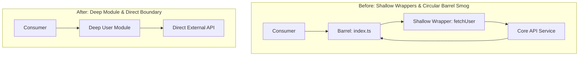

# Run TS Cleanup

A TypeScript codebase accumulates. Features get deprecated but their files stay. A refactor lands half-finished and both abstractions survive. An LLM writes `cn` for the fourth time in a fourth directory, launders types with `as any`, duplicates schemas alongside manual interfaces, and blankets properties in defensive `?.` optional chains. Dependencies outlive the code that imported them. Types get exported "just in case" and never consumed. In edge environments like Cloudflare Workers (`workerd`), agents hallucinate `process.env`, strip `ctx.waitUntil()` as "redundant", or delete `worker-configuration.d.ts` as an "unreferenced file".

This skill sweeps all of it into a clean, robust end state guided by **The 5 Pillars of TypeScript Project Cleanup**:

1. **Runtime & Platform Invariants (Platform Layer):** Preserve execution-model contracts — request-scoped `env`, async `ctx.waitUntil()` boundaries, ambient types (`worker-configuration.d.ts`), and RPC actor entry points (`DurableObject`, `WorkerEntrypoint`, `WorkflowEntrypoint`).
2. **Reachability & Dead Code (Graph Layer):** Prune unreferenced files, dead exports, orphaned dependencies, and abandoned zombie features using Knip with scoped, wave-safe fixes.
3. **Encapsulation & Boundary Integrity (Visibility Layer):** Enforce interface as test surface, eliminate test-only leak exports in production files, internalize in-file exports, and designate explicit public API entry points.
4. **Type System Rigor & Soundness (Semantic Layer):** Eradicate type laundering (`as any`, `as unknown as T`), maintain the type-coverage ratchet, enforce schema inference as single source of truth (`z.infer`), eliminate non-erasable syntax (`--erasableSyntaxOnly`), and ensure declaration-emit safety.
5. **Architectural Deepening & Structural Health (Architecture Layer):** Institutionalize Matt Pocock's Deletion Test, eliminate hypothetical seams and ghost interfaces (The Seam Test), counter micro-file fragmentation via locality and feature pods, eliminate barrel smog, and break dependency cycles.

- Every **dead symbol, file, export, type, and dependency** is found by a real engine, not by guesswork — and each finding is **triaged before deletion**, never deleted on the engine's word alone.
- Every deletion lands in a **reversible causal wave** behind a passing verification gate, so any single step reverts with one `git reset` or `git revert`.
- The **root cause** is addressed, not just the symptom: duplicate helpers get consolidated, circular barrels get untangled, single-use wrappers get inlined, and shallow abstractions are deepened — so the same bloat does not regrow.
- The codebase ends **more navigable and structurally sound than it started**, for the next agent and the next human, without a single unintended behavioral change.

This is a *finishing* tool. Run it on a green main branch, not mid-feature.

---

## When To Use

Trigger on phrases and repo states like:

- *"clean up this TypeScript project"*, *"my codebase is a mess"*, *"remove the dead code"*
- *"find unused dependencies"*, *"prune unused exports"*, *"delete orphaned files"*
- *"there's too much AI slop in here"*, *"tighten up the types"*, *"untangle these imports"*
- *"set up knip"*, *"run knip"*, *"why is this bundle so big"*
- *"audit this Cloudflare Worker"*, *"clean up workerd TypeScript"*, *"fix broken worker types"*
- Repo state: after a feature deprecation, a framework migration, or a long LLM-driven build-out.

Do **NOT** use this skill for:

- *Pure formatting or style-only changes* — run the project's own formatter; this skill deletes code.
- *Branch, worktree, and repo-artifact cleanup* — use `run-repo-cleanup`.
- *Reviewing a diff or PR* — use `run-review`.
- *A dirty working tree* — commit or stash first; Phase 0 refuses to start otherwise.
- *A red baseline* — fix the failing build or tests first. Cleanup on a broken repo cannot tell your breakage from its own.

---

## Modes

Pick the mode explicitly at the start, from the user's ask. Announce which one you picked. Escalating mid-run is fine; silently doing more than was asked is not.

| Mode | Runs | Fires on |
|---|---|---|
| **Sweep** | Phase 0-1, then lint autofix and Wave 1 only | *"tidy this up quickly"*, *"drop the dead files"* |
| **Standard** | Phases 0-3, then Waves 1-5 | *"clean up the dead code"* — **the default** |
| **Deep** | Standard, plus Phase 4 root-cause work, type hardening, and structural refactor | *"the codebase is a mess"*, *"make this maintainable"*, *"improve codebase architecture"* |

---

## The Engines

No single tool finds everything. Each engine sees one scope and is blind to the others.

| Engine | Finds | Scope | Autofix? |
|---|---|---|---|
| **Knip (v5/v6)** | Unused files, exports, types, dependencies, unlisted binaries, import cycles | Module graph | Yes — scoped per wave (`--fix-type files`, `exports`, `types`, `dependencies`) with native `--format` via Formatly |
| **Biome / Oxlint / ESLint / Ultracite** | Unused locals (`TS6133`), dead imports, correctness lint | File AST | Yes — native autofix per engine (`oxlint --fix-dangerously`, `biome check --write`) |
| **`tsc`** | Type errors, declaration-emit breakage (`TS4023`, `TS2742`), non-erasable syntax | Program | No — diagnostic verification gate (`tsc --noEmit` or `tsc -b --clean && tsc -b`) |
| **`type-coverage`** | `any`-creep score and untyped identifier coordinates | Program | No — numeric ratchet measurement (`--detail --strict`) |
| **`dpdm` / `madge`** | Circular dependency visualization & type-only vs runtime cycles | Import graph | No — inspection & verification (Knip also supports `--cycles`) |
| **anti-slop rules** | LLM-generated antipatterns (`as any`, schema drift, duplicate helpers) | File AST | Partial — targeted linters & ripgrep sweeps |

Knip and the linters are complements, not alternatives: Knip finds a file nothing imports, a linter finds an import nothing uses. Read [references/engines/engine-matrix.md](references/engines/engine-matrix.md) for the full matrix and the auto-detection protocol.

---

## Pinned Defaults

Decided once; override per-project only if the repo says otherwise (`AGENTS.md` / `CLAUDE.md` / `CONTRIBUTING.md` win over this skill).

| Key | Default | Why |
|---|---|---|
| **the gate** | `tsc --noEmit` (or `tsc -b` with `--clean` / `--outDir /tmp/dts-check` for composite projects) → `test` → `build` | The single verification barrier. Defined once in [references/remediation/waves.md](references/remediation/waves.md); every "Run the gate" in this skill means exactly that. |
| **branch** | `chore/ts-cleanup` | Never work on `main`. |
| **config file** | `knip.jsonc` (fallback `knip.json`) | JSONC carries comments explaining why each entry exists. Schema: `https://unpkg.com/knip@6/schema-jsonc.json` (or `@5`). |
| **package manager** | Detected from `packageManager` field, else lockfile | Never hardcode `pnpm` or run bare `npx tsc` (which can invoke obsolete `tsc@2.0.4`). Always use `$PM_EXEC tsc`. |
| **wave order** | Files → Barrels/Cycles → Encapsulation → Types → Dependencies | Causal order: pruning leaves first eliminates dead import branches; dependencies pruned last avoids TS2307 crashes. |
| **commit unit** | One commit per wave | Each wave reverts independently. |
| **suppression** | Targeted keys only | `ignoreDependencies`, `ignoreBinaries`, `ignoreExportsUsedInFile`, explicit `entry`. |

---

## Non-Negotiable Safety Rails

1. **Start green.** Verify `git status --porcelain` is empty, the typecheck passes, and the test suite passes before touching anything. A cleanup that begins on a red baseline cannot distinguish its own damage from pre-existing damage.
2. **Suppress false positives with targeted keys.** Reach for `ignoreDependencies`, `ignoreBinaries`, `ignoreExportsUsedInFile`, or an explicit `entry` — each one silences exactly the finding it names. A broad top-level `ignore` severs graph edges instead, so files the ignored code imports start reporting as dead and get deleted.
3. **Triage every finding before deleting it.** Apply the Three-Question Verification Test to each one. Framework entry points, dynamic imports, and RPC bindings are invisible to naive static analysis.
4. **Never run all-in-one `knip --fix`.** Running `--fix` with all fix types simultaneously deletes files, prunes exports, and mutates `package.json` in one un-audited pass. Always scope `--fix-type` to the specific wave (`--fix-type files` in Wave 1, `--fix-type exports` in Wave 3, etc.) and leverage `--format`.
5. **Delete in causal wave order.** Files first, then barrels and cycles, then internalizing exports, then unused types, then dependencies and lockfile sync.
6. **Run the gate after every wave, before every commit.** A wave that fails the gate is reverted or fixed, never committed.
7. **Prove declaration-emit safety before un-exporting.** `tsc --noEmit` checks the implementation graph, not the declaration graph. For composite projects or published libraries, prove `.d.ts` emit using `--declaration --emitDeclarationOnly --outDir /tmp/dts-check` or `tsc -b --clean && tsc -b`. In TS 5.8+, `tsc -b --noEmit` is supported, but CLI `--outDir` remains forbidden on `-b`.
8. **Preserve Cloudflare Workers (`workerd`) invariants.** Never delete `worker-configuration.d.ts`, never prune `@cloudflare/workers-types`, never strip `ctx.waitUntil()`, and never access `process.env` in worker handlers.
9. **Fix the cause, then the symptom.** Consolidate duplicate copies of `cn` before deleting them; migrate callers before pruning an abstraction.

---

## Priority Section: Cloudflare Workers (`workerd`) Invariants

Cloudflare Workers runs on Cloudflare's open-source `workerd` V8 isolate runtime, not Node.js. AI agents and generic cleanup tools consistently make catastrophic mistakes in Workers codebases due to assuming Node.js runtime behavior. When auditing or cleaning up a Workers project, prioritize these non-negotiable rules:

```
┌────────────────────────────────────────────────────────────────────────┐
│                   CLOUDFLARE WORKERS (WORKERD) INVARIANTS               │
├──────────────────────────────────┬─────────────────────────────────────┤
│ 1. Ambient Types Protection      │ 2. Platform Lifecycle & RPC Classes │
│    • worker-configuration.d.ts   │    • ExportedHandler (fetch/queue)  │
│    • @cloudflare/workers-types   │    • DurableObject, WorkerEntrypoint│
│    • @cloudflare/vitest-pool     │    • WorkflowEntrypoint classes     │
├──────────────────────────────────┼─────────────────────────────────────┤
│ 3. Runtime Environment Isolation │ 4. Async Boundary Safety            │
│    • No global process.env       │    • ctx.waitUntil(promise)         │
│    • Request-scoped env binding  │    • Zero floating background tasks │
│    • this.env in RPC classes     │    • Prevent isolate suspension     │
└──────────────────────────────────┴─────────────────────────────────────┘
```

### 1. Ambient Type & Dependency Protection (`wrangler types`)
- **`worker-configuration.d.ts` (or `env.d.ts`)**: Generated by running `npx wrangler types`. It contains ambient type declarations for KV, D1, R2, Queues, and secrets. Because it contains no imports or exports, **naive dead-file sweeps will flag it as unreferenced**. You must protect it in `knip.jsonc` (`entry: ["src/index.ts", "worker-configuration.d.ts"]` or in `ignore`). **Never delete this file.**
- **`@cloudflare/workers-types` & `@cloudflare/vitest-pool-workers`**: These dependencies are configured in `tsconfig.json` (`compilerOptions.types`) and `vitest.config.ts`, not imported in application source files. Knip will report them as unused dependencies. Always add them to `ignoreDependencies` in `knip.jsonc`.

### 2. Platform Entry Points & RPC Actor Protection
- **`ExportedHandler<Env>`**: The root handler in `src/index.ts` default-exports an object implementing `fetch`, `scheduled`, `queue`, `email`, or `tail`. These methods are invoked by the platform runtime upon cron or queue events, not by local TypeScript imports. Never strip these lifecycle exports.
- **RPC & Stateful Classes**: Classes extending `DurableObject`, `WorkerEntrypoint`, or `WorkflowEntrypoint` are referenced in `wrangler.json` (e.g. `"bindings": [{"name": "COUNTER", "class_name": "Counter"}]`) and called via service bindings or RPC.
  > [!CRITICAL]
  > **Knip's built-in `wrangler` plugin only inspects `config.main`.** It does NOT inspect `durable_objects`, `workflows`, or service bindings in `wrangler.json`. Any RPC class in a separate file (e.g. `src/objects/counter.ts` or `src/workflows/order.ts`) will be reported as an unused file or unused export!
  > **Defense:** Protect them by adding them to `entry` in `knip.jsonc` (e.g. `"entry": ["src/index.ts", "src/workflows/**/*.ts!"]`) or marking their exports with JSDoc `/** @public */` alongside `"includeEntryExports": false`.

### 3. `process.env` Eradication & Request-Scoped `env`
In `workerd`, `process.env` is **not** populated with bindings or secrets. At runtime, `process.env.MY_SECRET` returns `undefined`, leading to silent authentication failures or crashes:
```typescript
// ❌ WRONG (Node.js leak — crashes in workerd):
export async function getDb() {
  return drizzle(process.env.DB_URL!); // Returns undefined!
}

// ✅ CORRECT (Edge-native request-scoped env drilling):
export function getDb(env: Env) {
  return drizzle(env.PROD_DB);
}
```
In `DurableObject` and `WorkerEntrypoint` classes, access bindings via `this.env`:
```typescript
export class AnalyticsWorker extends WorkerEntrypoint<Env> {
  async record(event: string) {
    await this.env.ANALYTICS_KV.put(event, Date.now().toString());
  }
}
```

### 4. Async Boundary Safety (`ctx.waitUntil`)
In `workerd`, when the Promise returned by `fetch()` settles with a `Response`, the V8 isolate is immediately suspended or terminated. Un-awaited background promises are aborted mid-flight:
```typescript
// ❌ WRONG (Floating promise killed when Response is returned):
export default {
  async fetch(req, env, ctx) {
    env.AUDIT_QUEUE.send({ url: req.url }); // Aborted mid-flight!
    return new Response("OK");
  }
} satisfies ExportedHandler<Env>;

// ✅ CORRECT (Protects background work until complete):
export default {
  async fetch(req, env, ctx) {
    ctx.waitUntil(env.AUDIT_QUEUE.send({ url: req.url }));
    return new Response("OK");
  }
} satisfies ExportedHandler<Env>;
```
Never strip or unwrap `ctx.waitUntil()` calls as "redundant wrappers".

### 5. Canonical `knip.jsonc` for Cloudflare Workers
```jsonc
{
  "$schema": "https://unpkg.com/knip@6/schema-jsonc.json",
  "wrangler": true,
  "vitest": true,
  "entry": [
    "src/index.ts",
    "worker-configuration.d.ts",
    "src/workflows/**/*.ts!"
  ],
  "project": ["src/**/*.{ts,tsx}", "test/**/*.{ts,tsx}"],
  "includeEntryExports": false,
  "ignoreExportsUsedInFile": {
    "interface": true,
    "type": true
  },
  "ignoreDependencies": [
    "@types/*",
    "@cloudflare/workers-types",
    "@cloudflare/vitest-pool-workers"
  ],
  "ignore": [".wrangler/**"]
}
```

---

## The 10 Sins of Agent-Written TypeScript

AI agents introduce structural bloat due to bounded context windows, lack of cross-file memory, and pressure to make compiler checks green at all costs:

1. **Type Laundering & Cast Cascades:** Reaching for `as any`, `as unknown as T`, or chained non-null assertions (`x!.y!.z!`) when encountering complex generics or external API payloads.
   - *Fix:* Parse boundaries using runtime schemas (`zod.safeParse()`) or validate internal object shapes using `satisfies`.
2. **Schema-Type Dual Declaration Drift:** Manually declaring an `interface User` right next to `const UserSchema = z.object({...})`. Over time, one drifts from the other.
   - *Fix:* Enforce Single Source of Truth: `export type User = z.infer<typeof UserSchema>;`.
3. **Defensive Null Paranoia & Optional Chaining Smog:** Writing `a?.b?.c?.d` 4 levels deep or `if (x && x.y && x.y.z)` on strictly typed internal models.
   - *Fix:* Trust domain models; restrict optional chaining to unvalidated external inputs or genuinely optional fields.
4. **Barrel Smog & Circular Dependency Loops:** Creating `index.ts` with `export * from './...'` in every folder, then importing siblings back through that barrel.
   - *Fix:* Ban internal files from importing through their own directory barrel; use direct relative imports and explicit named exports.
5. **Mock & Test Utility Bleed into Production:** Exporting `mockUserData`, `createTestClient`, or private `_helper` from production files so unit tests can import them.
   - *Fix:* Relocate mocks to `test/` or `__mocks__/`; test observable behavior through the public module interface ("Replace, don't layer").
6. **Phantom Interfaces & Speculative Generics (The Seam Sin):** Creating `interface IUserService` with exactly one class `UserService`, or generic abstractions `function run<T = unknown>()` "just in case".
   - *Fix:* Apply the Seam Test: "One implementation = hypothetical seam; two implementations = real seam." Delete single-implementation interfaces.
7. **Anemic Type Guards & Unsound Narrowing:** Writing `val is User` with `typeof val === 'object' && val !== null` without checking mandatory fields.
   - *Fix:* Validate all required properties or delegate to `UserSchema.safeParse(val).success`.
8. **Shallow Wrappers & Passthrough Indirection (The Deletion Sin):** Creating 1-line functions that do nothing but pass arguments to another function (`const getX = (id) => api.get(id)`).
   - *Fix:* Apply the Deletion Test: if deleting the wrapper causes zero complexity loss, inline it into the caller.
9. **Utility Dumping Ground vs. Locality:** Dumping 3-line string, date, or styling functions into `src/utils/` instead of keeping them local to their feature.
   - *Fix:* Follow the 1-to-1 Rule: colocate single-consumer helpers in the consumer file (< 25 LOC). Enforce the Rule of Three before promoting to shared utilities.
10. **Non-Erasable TypeScript Syntax:** Using enums, namespaces, and constructor parameter properties in projects targeting modern bundlers (esbuild, SWC, Vite) that strip types without full type checking.
    - *Fix:* Comply with `--erasableSyntaxOnly` (introduced in TS 5.8). Replace enums with string literal unions (`type Status = 'active' | 'inactive'`) and use explicit property declarations.

---

## Architectural Deepening (Matt Pocock / AIHero Framework)

In **Deep mode**, cleanup is not just line deletion; it is structural improvement. We integrate Matt Pocock's architecture deepening philosophy into pure Markdown reports (`codebase-health.md`):

### 1. YAGNI Hot-Spot Scoping
Do not waste time refactoring cold, dormant files that haven't changed in months. Target modules with active churn:
```bash
git log --oneline -n 100 -- src/
```
Focus structural refactoring where development velocity is actively impeded.

### 2. Recommendation Strength Badges
Classify every architectural proposal with explicit confidence ratings:
- `[STRONG]`: Clear win with concrete precedent and immediate payoff (e.g. inlining single-use pass-through wrapper, removing cyclic barrel).
- `[WORTH EXPLORING]`: Worth considering; has architectural trade-offs that benefit from team alignment (e.g. grouping micro-files into feature pods).
- `[SPECULATIVE]`: High risk or only beneficial at massive scale; defer unless current pain is severe (e.g. introducing hexagonal ports and adapters).

### 3. The Deletion Test & The Seam Test
- **The Deletion Test:** *"If you deleted this layer/wrapper, what would break?"* If the answer is "nothing, or the code becomes simpler and more direct", delete and inline it. If real complexity spills out into callers, deepen the module behind a clean interface.
- **The Seam Test:** *"Is this interface hiding a real variation, or a hypothetical one?"* One adapter is a hypothetical seam (cognitive bloat); two adapters is a genuine seam. Export concrete classes/functions directly until a second implementation exists.

### 4. Before / After Architecture Diagrams
In `codebase-health.md`, illustrate structural transformations with Mermaid flowcharts:



---

## The Six Phases

```
        dead code · unused deps · AI slop · weak types · tangled imports
                              │
   Phase 0 — Baseline: clean tree, green typecheck, green tests, branch cut
                              │
   Phase 1 — Engine setup: detect stack, resolve manager, configure knip v6
                              │
   Phase 2 — Survey: run engines, batch findings (1-9), detect cycles
                              │
   Phase 3 — Triage: apply Three-Question Test, classify verdicts
                              │
   Phase 4 — Architectural Deepening: inlining, seams, zod inference, [Deep]
             workerd invariants, codebase-health.md
                              │
   Phase 5 — Waves: scoped deletions, verification gate, one commit per wave
                              │
     zero dead code · green gate · one revertable commit per wave · clean repo
```

### Phase 0 — Baseline
1. Verify clean git working tree: `test -z "$(git status --porcelain)"`
2. Cut branch: `git checkout -b chore/ts-cleanup`
3. Resolve package manager ($PM_EXEC) and verify baseline gate: `$PM_EXEC tsc --noEmit && $PM_EXEC test`
4. Record baseline metrics (finding counts, `type-coverage` %, cycle count).

### Phase 1 — Engine Setup
1. Detect installed engines using `python3 scripts/audit-ts-health.py --target .`
2. Generate/review Knip config: `python3 scripts/init-knip-config.py --format jsonc`
3. If Cloudflare Workers: verify ambient type preservation (`worker-configuration.d.ts`), RPC entrypoints, and `@cloudflare/workers-types` ignores.
4. Ensure zero broad top-level `ignore` patterns in configuration.

### Phase 2 — Survey
1. Batch dead-code findings:
   ```bash
   python3 scripts/batch-findings.py --run --output markdown --out-file cleanup-plan.md
   ```
2. Survey import cycles: `knip --cycles` or `npx madge --circular --extensions ts,tsx src/`
3. Measure type soundness: `$PM_EXEC type-coverage --detail`
4. Audit slop markers: chained casts (`as any`), schema drift, `process.env` in workers.

### Phase 3 — Triage
Apply the **Three-Question Verification Test** to every finding:
1. **Framework lifecycle?** Invoked by convention without import (Next.js route, Worker `fetch`/`scheduled`, Remix loader)?
2. **Dynamic invocation?** Reached via string-keyed registry, `import()`, or RPC service binding?
3. **Public contract?** Exported to external consumers or ambient declaration table?

Mark each item in `cleanup-plan.md` as `dead`, `false-positive`, or `deferred`.

### Phase 4 — Architectural Deepening & Root Cause (Deep Mode)
1. Colocate single-consumer helpers into feature pods (< 25 LOC).
2. Apply the Deletion Test to inline shallow passthrough wrappers.
3. Apply the Seam Test to delete single-implementation ghost interfaces.
4. Replace manual interfaces with `z.infer<typeof Schema>`.
5. Break barrel cycles by replacing `export *` with direct named imports.
6. Eradicate `process.env` in worker handlers and wrap background tasks in `ctx.waitUntil()`.
7. Generate `codebase-health.md` with Mermaid before/after diagrams.

### Phase 5 — The 5 Causal Waves

Each wave runs behind a passing verification gate and is committed atomically:

| Wave | Deletes | Scoped Knip Autofix | Gate Verification | Commit Message |
|---|---|---|---|---|
| **1** | Unreferenced files | `knip --fix-type files --allow-remove-files --format` | Full gate | `chore: remove unreferenced files` |
| **2** | Barrel re-exports & cycles | Manual refactor / direct imports | Full gate + cycle check | `refactor: prune dead barrels and break cycles` |
| **3** | Test leaks & private exports | `knip --fix-type exports --format` | Full gate | `refactor: internalize private exports` |
| **BRIDGE** | Linter cleanup | Biome / Oxlint / ESLint | Clears `TS6133` unused locals | `chore: linter autofix after un-export` |
| **4** | Unused types & enums | `knip --fix-type types --format` | Full gate + declaration emit check | `refactor: prune dead types` |
| **5** | Unused dependencies | `knip --fix-type dependencies --format` | Full gate + lockfile sync | `chore(deps): prune unused dependencies` |

---

## Common Mistakes

| Mistake | Consequence | Instead |
|---|---|---|
| Running all-in-one `knip --fix` | Deletes files, exports, and packages in one un-audited pass; causes unbisectable breakage | Scope `--fix-type` per wave (`files`, `exports`, `types`, `dependencies`) and use `--format` |
| Assuming Knip's wrangler plugin protects RPC classes | It only parses `config.main`; DurableObjects, WorkerEntrypoints, and Workflows get deleted | Protect RPC classes via `entry` in `knip.jsonc` or mark with JSDoc `/** @public */` |
| Deleting `worker-configuration.d.ts` in Cloudflare Workers | Destroys ambient bindings; `env: Env` immediately fails typecheck across worker | Protect in `knip.jsonc` `entry` or `ignore`; never delete ambient declarations |
| Accessing `process.env` in Cloudflare Workers | Returns `undefined` at runtime in `workerd` isolates; causes silent production crashes | Drill request-scoped `env` parameter or access `this.env` in RPC classes |
| Stripping `ctx.waitUntil()` as "redundant wrapper" | Isolate suspends on response settle; background logs, queues, and metrics are aborted | Preserve `ctx.waitUntil()` for all edge background work |
| Running bare `npx tsc` | If typescript is not in local node_modules, invokes obsolete `tsc@2.0.4` published in 2017 | Always use `$PM_EXEC tsc` (e.g. `pnpm exec tsc`, `bun x tsc`, or `npx -p typescript tsc`) |
| Passing `--no-config-lookup` in ESLint v9 for TS | Disables config resolution entirely; defaults to basic JS parser and fails on `.ts` files | Use flat config (`eslint.config.mjs`) or invoke targeted linter rules |
| Trusting `tsc -b --noEmit` on older TS versions | Fails with fatal error `TS5094` in TypeScript < 5.8 | In TS < 5.8, use `tsc --declaration --emitDeclarationOnly --outDir /tmp/dts-check` |
| Passing `--isolatedDeclarations` without `--declaration` | Fails with `TS5069: Option isolatedDeclarations cannot be specified without declaration` | Pair with `--declaration --emitDeclarationOnly --outDir /tmp/dts-check` |
| Broad top-level `"ignore": ["src/legacy/**"]` in Knip | Knip halts graph traversal; imports within those files report as dead and get deleted | Use targeted keys: `ignoreDependencies`, `ignoreBinaries`, `ignoreExportsUsedInFile` |
| Dual declaration of Zod schema + manual TypeScript interface | Types drift silently when schemas are updated | Use `type T = z.infer<typeof TSchema>` as single source of truth |
| Exporting internal helpers solely for unit tests (`_helper`) | Leaks implementation details into public API; breaks encapsulation | Test observable outcomes across public interface ("Replace, don't layer") |
| Single-implementation `IUserService` interfaces | Creates ghost interfaces and doubles file/type maintenance burden | Export concrete implementation directly until a second adapter genuinely exists (Seam Test) |
| Dumping single-consumer helpers into `src/utils/` | Context fragmentation; creates circular webs and junk drawers | Colocate in consumer file (< 25 LOC) or feature pod (1-to-1 Rule) |
| Using enums / namespaces with modern transpilers | Fails `--erasableSyntaxOnly` (TS 5.8+); causes bundler transpile friction | Use string literal unions and standard classes |

---

## Scripts

Python 3 stdlib only — no dependencies, no network beyond the engines they invoke.

| Script | Phase | Purpose | Mutates? |
|---|---|---|---|
| `scripts/audit-ts-health.py` | 1, 4 | Detects linters and formatters, audits `tsconfig.json` flags, finds import cycles, flags AI slop markers & schema drift. | No |
| `scripts/init-knip-config.py` | 1 | Scans frameworks and monorepo layout; emits `knip.jsonc`/`knip.json` with a valid `$schema` (`knip@6`) and built-in compilers. | Yes — `--dry-run` to preview, `--force` to overwrite |
| `scripts/batch-findings.py` | 2 | Runs or parses the dead-code and analysis engines; batches findings across all 9 batches, scores risk, renders gates. | Only with `--out-file` |

---

## References

- [references/engines/engine-matrix.md](references/engines/engine-matrix.md) — which engine finds which problem, at what scope and speed; auto-detection protocol.
- [references/engines/knip-configuration.md](references/engines/knip-configuration.md) — Knip v6 config formats, schema, monorepo isolation, compilers, plugin catalog, and targeted ignores.
- [references/engines/lint-engines.md](references/engines/lint-engines.md) — Biome, Oxlint (`--fix-dangerously`), ESLint (Flat Config v9), and Ultracite recipes.
- [references/engines/analysis-engines.md](references/engines/analysis-engines.md) — `type-coverage`, native Knip cycles (`knip --cycles`), `madge`, and anti-slop rules.
- [references/detection/finding-classification.md](references/detection/finding-classification.md) — the nine batches, which engine produces each, the wave each feeds, and the risk model.
- [references/detection/false-positive-triage.md](references/detection/false-positive-triage.md) — the Three-Question Test, framework entry catalogs, dynamic imports, public contracts, and false positives.
- [references/detection/code-slop-catalog.md](references/detection/code-slop-catalog.md) — the 10 Sins of Agent-Written TypeScript, architectural origins of bloat, detection commands, and before/after remediation.
- [references/runtimes/cloudflare-workers.md](references/runtimes/cloudflare-workers.md) — Cloudflare Workers (`workerd`) deep guide: wrangler types, RPC class preservation (DurableObject, WorkerEntrypoint), process.env eradication, and ctx.waitUntil safety.
- [references/remediation/waves.md](references/remediation/waves.md) — **the gate**, package-manager resolution, all five waves, the linter bridge, rollback, and the post-flight metrics gate.
- [references/remediation/structural-refactor.md](references/remediation/structural-refactor.md) — Matt Pocock architectural deepening: inlining wrappers, breaking cycles, restructuring barrels, co-locating helpers, deep modules vs shallow abstractions.
- [references/remediation/complexity-thresholds.md](references/remediation/complexity-thresholds.md) — cyclomatic and cognitive complexity thresholds and code-smell index.
- [references/types/strict-migration.md](references/types/strict-migration.md) — eliminating `any`-creep, type-coverage ratchet, incremental strict-mode migration, type tidying.
- [references/types/declaration-emit.md](references/types/declaration-emit.md) — declaration emit safety, TS 5.8+ build options, `--isolatedDeclarations`, TS4023/4081/4082/4060/2742/2883 matrix, and pre-un-export checklist.

---

## Bottom Line

Prove green → configure engines & protect platform invariants → survey all scopes across 9 batches → triage with Three-Question Test → deepen architecture & address root causes → delete in five scoped, gated waves → report the deltas.
